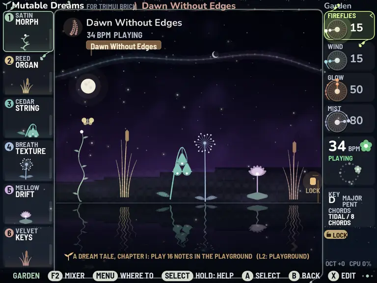

# Mutable Dreams for handhelds

**A garden of sound that makes music by itself – and answers you.**

Mutable Dreams is a generative instrument for handhelds. It plays by itself, the way a garden grows by itself: six tracks are six plants, four dials are the weather. Around it are 272 Biomes, 96 worlds, a Sound Lab with modules after Mutable Instruments (Plaits, Rings, Elements, Clouds, Beads, Marbles, Grids, Tides), ten musical toys, a dream tale, and a manual with seven worked examples. English and German.

**Website with every function explained, in pictures: <https://kidbee85-beep.github.io/mutable-dreams-handheld/>**
([Deutsch](https://kidbee85-beep.github.io/mutable-dreams-handheld/de/))

## Download

Everything is in the [latest release](https://github.com/kidbee85-beep/mutable-dreams-handheld/releases/latest):

| Device | File |
|---|---|
| Trimui Brick (Knulli) | `Mutable-Dreams-Brick-1.5.9.zip` |
| Miyoo Mini Plus (Onion OS) | `Mutable-Dreams-Miyoo-Mini-Plus-Onion-1.5.9.zip` |
| Miyoo Mini and Mini Flip (Onion OS) | `Mutable-Dreams-Miyoo-Mini-Onion-1.5.9.zip` |
| Powkiddy RGB20S (AmberELEC) | `Mutable-Dreams-RGB20S-AmberELEC-1.5.9.zip` |
| Anbernic H700 (Knulli), *community test* | `Mutable-Dreams-Anbernic-H700-Knulli-1.5.9.zip` |
| Android | `Mutable-Dreams-Android-1.5.9.apk` |
| Linux PC | `Mutable-Dreams-Linux-OS-x86_64-1.5.9.zip`, `…-aarch64-1.5.9.zip` |
| Manual (English, German) | `Mutable-Dreams-Manual-EN.pdf`, `Mutable-Dreams-Handbuch-DE.pdf` |

Checksums: `SHA256SUMS.txt`. The H700 package has not been run on a real H700 yet: if you try it, please send `mutabledreams/log.txt`.

## Controls in one minute

- `B` goes one step back; hold `B` to go home. `START` plays and stops.
- **On handhelds without a MENU key** (Miyoo, RGB20S, H700, Android gamepads): tap `SELECT` for the menu (every place, the options, **Quit**); hold `SELECT` for the help; tap `L2` for the quick bar.
- On Android without a gamepad, the Brick's buttons are on the screen beside the stage.

## This repository

| Folder | What |
|---|---|
| `src/` | The port's sources (GPL-3.0): core, stage, SDL front end, launchers, tests, tools, Android project |
| `docs/` | The website (GitHub Pages), generated by `site-src/build.py` |
| `site-src/` | The website's generator |
| `BUILDING.md` | How to build, test and package |
| `NOTICE.md` | Third-party code and credits |

The port is built from the unchanged **Mutable Dreams 2.1** sources ([kidbee85-beep/mutable-dreams](https://github.com/kidbee85-beep/mutable-dreams), release v2.1) plus the port layer in `src/`.

## Licence and credits

GPL-3.0-only. Mutable Instruments code by Émilie Gillet (MIT; Grids GPL-3.0-or-later), stb_vorbis (public domain), fonts Barlow and Nunito (SIL OFL), SDL2 (zlib), voices from LibriVox (public domain). Independent from Mutable Instruments, M-VAVE, Trimui, Anbernic, Miyoo and Powkiddy. Made by Kid Bunka. See [NOTICE.md](NOTICE.md).

---

# Mutable Dreams für Handhelds

**Ein Garten aus Klang, der von selbst Musik macht – und dir antwortet.**

Mutable Dreams ist ein generatives Instrument für Handhelds. Es spielt von selbst, so wie ein Garten von selbst wächst: sechs Spuren sind sechs Pflanzen, vier Regler das Wetter. Dazu kommen 272 Biome, 96 Welten, ein Klanglabor mit Modulen nach Mutable Instruments, zehn musikalische Spielzeuge, eine Traumgeschichte und ein Handbuch mit sieben Beispielen. Deutsch und Englisch.

**Webseite mit allen Funktionen in Bildern: <https://kidbee85-beep.github.io/mutable-dreams-handheld/de/>**

**Download:** siehe [neuestes Release](https://github.com/kidbee85-beep/mutable-dreams-handheld/releases/latest) (Tabelle oben). Das H700-Paket ist ein Community-Test: Es lief noch auf keinem echten H700; wer es probiert, schickt bitte `mutabledreams/log.txt`.

**Tasten:** `B` geht zurück, `B` gehalten nach Hause. Auf Geräten ohne MENU-Taste öffnet ein Tipp auf `SELECT` das Menü (alle Orte, Optionen, **Beenden**), `SELECT` gehalten zeigt die Hilfe, `L2` öffnet die Schnellleiste. Auf Android ohne Gamepad liegen die Tasten neben der Bühne auf dem Bildschirm.

**Bauen:** siehe [BUILDING.md](BUILDING.md). Lizenz GPL-3.0-only, Dank und Lizenzen der übernommenen Teile in [NOTICE.md](NOTICE.md).
